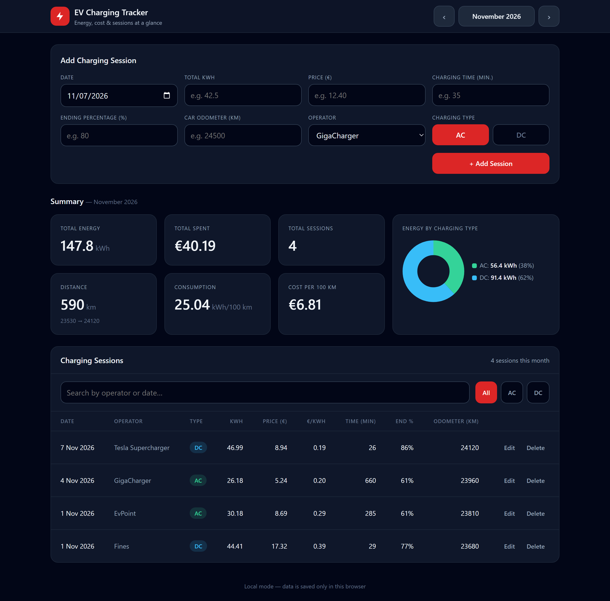
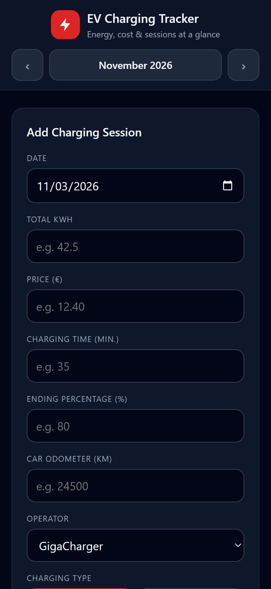
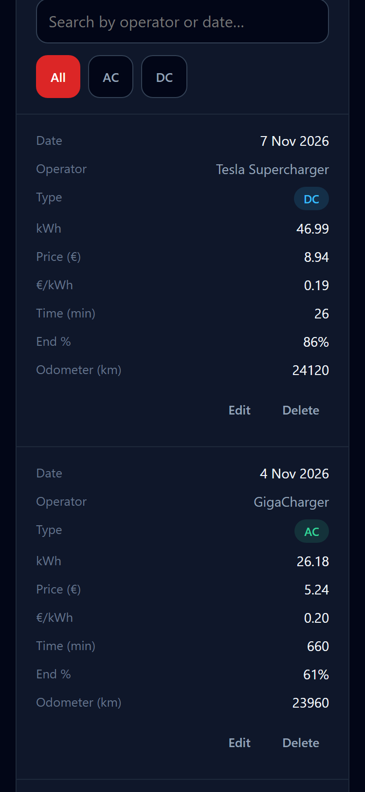

# EV Charging Tracker

Log your EV charging sessions from your phone right after charging, or from your computer. Every session is saved straight into your own Google Sheet.

- One private link that works on the phone and on the computer
- Your data stays in your own Google account. No servers, no subscriptions, nothing to install
- Works with any electric car



<p>
  
  
</p>

*Screenshots show sample data.*

## Features

- Add, edit and delete sessions: date, operator, AC/DC, kWh, price, charging time, ending %, odometer
- Monthly view with summary cards (energy, money spent, number of sessions) and an AC/DC chart
- Search by operator or date and filter by AC / DC
- Price per kWh is calculated for you
- Made for the phone: big buttons, and you can type `5,10` or `5.10`

## Try it first (optional)

1. Download the project: on GitHub click **Code → Download ZIP** and unzip it.
2. Double-click `dist/Index.html`. It opens in your browser with sample data.

In this mode the data is kept only in that browser. To save into Google Sheets, follow the setup below.

## Setup

It takes about 10 minutes and you do it only once. You need a Google account and a computer.

### 1. Prepare the Google Sheet

You can use a sheet you already keep or start a new one at [sheets.google.com](https://sheets.google.com). The app expects this layout:

| | B | C | D | E | F | G | H | I | J |
|---|---|---|---|---|---|---|---|---|---|
| **Row 3** | Date | Operator | Energy (kWh) | Price (EUR) | Time (min) | Type | Price per kWh | Odometer | Ending % |
| **Row 4** | *(empty)* | | | | | | | | |
| **Row 5+** | sessions, newest on top | | | | | | | | |

- Column A and rows 1–2 can hold anything you like, such as a title.
- Row 3 holds the headers. You can name them in any language; the app only looks at the column positions.
- Leave row 4 empty. New sessions are always added at row 5, so totals you build from row 4, such as `=SUM(D4:D200)`, include them automatically.
- Column G must be `AC` or `DC`. The sessions end at the last row with `AC`/`DC`, so you can keep totals and statistics below them. Just don't write `AC` or `DC` in column G of those statistics.
- Column H is filled in by the app with the formula `=ROUND(E/D, 2)`.
- If you already have sessions, put them from row 5 down, newest first. Dates can be written as `31.10.2026`.

The file must be a real Google Sheet. If you uploaded an Excel file and you see an **.XLSX** label next to its name, use **File → Save as Google Sheets** and continue with the new copy.

### 2. Add the code to the sheet

You need two files from this repository. You don't have to download anything: open each file on GitHub and click the **Copy raw file** button (two squares icon) above the code.

- [`apps-script/Code.gs`](apps-script/Code.gs) reads and writes the sheet
- [`dist/Index.html`](dist/Index.html) is the app itself

Then:

1. In your Google Sheet open **Extensions → Apps Script**. A new tab opens.
2. Click **Untitled project** at the top left and rename it to `EV Charging Tracker`.
3. Open the file **Code.gs** on the left, delete everything in it and paste `Code.gs`.
4. Next to **Files** click **+ → HTML** and name the file exactly `Index` (capital I, no `.html`).
5. Delete everything in it and paste `Index.html`.
6. Press **Ctrl+S** (or **Cmd+S** on a Mac) to save.

Make sure each file got the right code. Code.gs starts with `/**`, Index.html starts with `<!DOCTYPE html>`.

### 3. Publish it as a web app

1. At the top right click **Deploy → New deployment**.
2. Click the gear icon next to **Select type** and choose **Web app**.
3. Fill in:
   - Description: `EV Charging Tracker`
   - Execute as: **Me**
   - Who has access: **Only myself**
4. Click **Deploy**.
5. Google asks for permission. Click **Authorize access** and choose your account.
   - You will see **"Google hasn't verified this app"**. That's expected: you are the author of this script, so nobody else has checked it.
   - Click **Advanced → Go to EV Charging Tracker (unsafe) → Allow**.
   - The script asks only for access to this one spreadsheet, not to your other files.
6. Copy the **Web app URL**. It ends with `/exec`. This is your app's link. Keep it private.

### 4. Check that it works

1. Open the link. At the bottom of the page it should say **"Data is saved in your Google Sheet"** and your sessions should be listed.
2. Add a test session and look at the sheet: it should be on row 5 and the price per kWh should be filled in.
3. Delete the test session in the app with **Delete**.

If something goes wrong, **File → Version history** in the sheet brings back any earlier state.

### 5. Add it to your phone

Open the link on your phone, signed in to the same Google account, and add it to the home screen:

- **iPhone (Safari):** Share button → **Add to Home Screen**
- **Android (Chrome):** menu ⋮ → **Add to Home screen**

On the computer you can bookmark the link or create a desktop shortcut to it.

## How to use

- **Add a session:** fill in the form and press **+ Add Session**. The date defaults to today.
- **Operator:** pick one from the list. For a new one choose **+ New operator…** and type the name. If you type an existing name in different letters, like `evpoint`, the existing spelling (`EvPoint`) is used.
- **AC / DC:** the app selects the type you used last time with that operator. Change it if needed.
- **Numbers:** both `23,45` and `23.45` work. kWh and price are rounded to 2 decimals (`23,457` becomes `23,46`).
- **Edit or delete:** use **Edit** or **Delete** on the session in the list.
- **Other months:** use the **‹** and **›** arrows at the top.
- **Search and filter:** search by operator or date (for example `02.11`) and use **All / AC / DC**.

You can still edit the sheet by hand. If you change it while the app is open, reload the app before you edit or delete a session there.

## Customize

- **Operators:** the list in the app is built from the operators already in your sheet plus a default list of Bulgarian operators. To change the defaults, edit `DEFAULT_OPERATORS` at the top of `src/script.js` and rebuild (see [For developers](#for-developers)).
- **Which tab is used:** `SHEET_ID` at the top of `Code.gs` is the number after `#gid=` in your sheet's address. If it doesn't match any tab, the first tab is used. If your sessions are on another tab, put its number there.

## Updating to a new version

1. Copy the new `Code.gs` and `dist/Index.html` into Apps Script again, the same way as in step 2, and save.
2. **Deploy → Manage deployments** → pencil icon ✏️ → **Version: New version** → **Deploy**.

The link stays the same, so the phone shortcut keeps working.

## Troubleshooting

- **"Sorry, unable to open the file at this time":** this happens when the browser is signed in to several Google accounts. Open the link in a window that is signed in only to the account that owns the sheet, for example a private window.
- **"Not saved: The sheet was changed in the meantime…":** the sheet was edited by hand while the app was open. Reload the app and try again.
- **An error on Deploy that mentions Code.gs:** the HTML was probably pasted into Code.gs. Paste each file into the right place again (step 2).
- **"Row … in the Google Sheet could not be read":** that row has no readable date in column B or no `AC`/`DC` in column G. Fix it in the sheet and reload the app.
- **No sessions are shown:** check that column G of your sessions says `AC` or `DC` and that they start at row 5.

## Known limitations

- Needs internet. Without a connection a session can't be saved, but the form keeps what you typed.
- The app is in English.

## For developers

The code is plain HTML, CSS and JavaScript with no libraries. Edit the files in `src/`, then build:

```powershell
powershell -ExecutionPolicy Bypass -File .\build.ps1
```

`build.ps1` puts the CSS and JS into one file, `dist/Index.html`, because Apps Script can only serve HTML files. Don't edit `dist/Index.html` by hand. On macOS or Linux, run it with PowerShell 7 (`pwsh ./build.ps1`).

| File | Purpose |
|---|---|
| `src/index.html` | Page structure. Opens directly in a browser for local testing. |
| `src/style.css` | Styles |
| `src/media.css` | Layout for tablets and phones |
| `src/script.js` | App logic. Uses the Google Sheet inside Apps Script, otherwise `localStorage` with sample data. |
| `apps-script/Code.gs` | Reads, adds, edits and deletes rows in the sheet |
| `dist/Index.html` | Generated by `build.ps1`, the file that goes into Apps Script |
| `assets/icon.ico` | Icon for a desktop shortcut to the app (not part of the app itself) |
| `docs/screenshots/` | Screenshots used in this README |

## License

[MIT](LICENSE)
